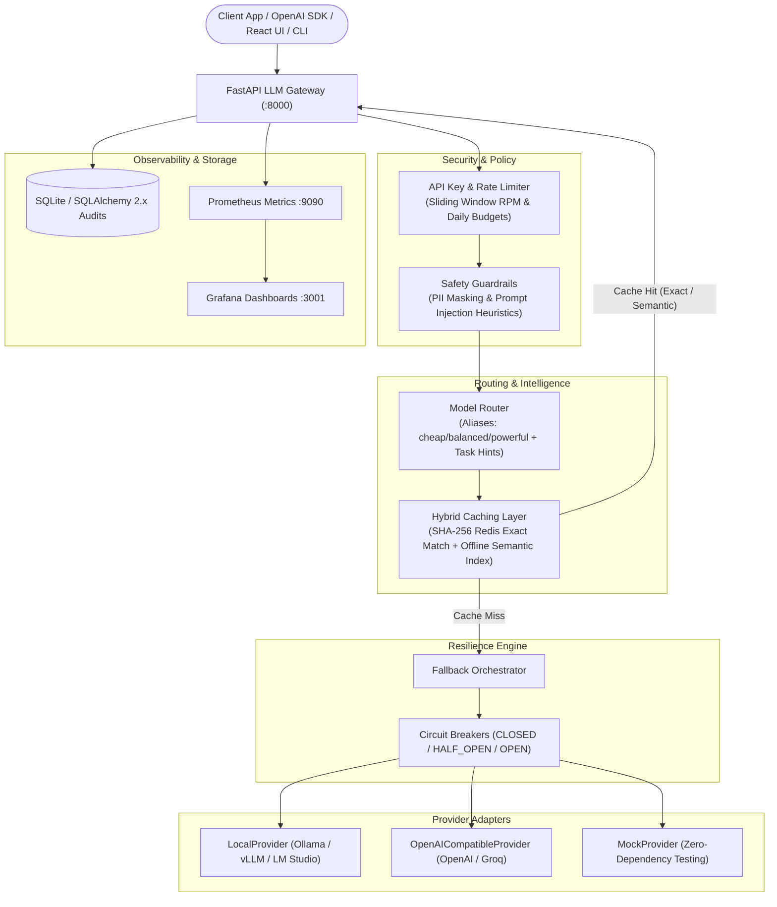
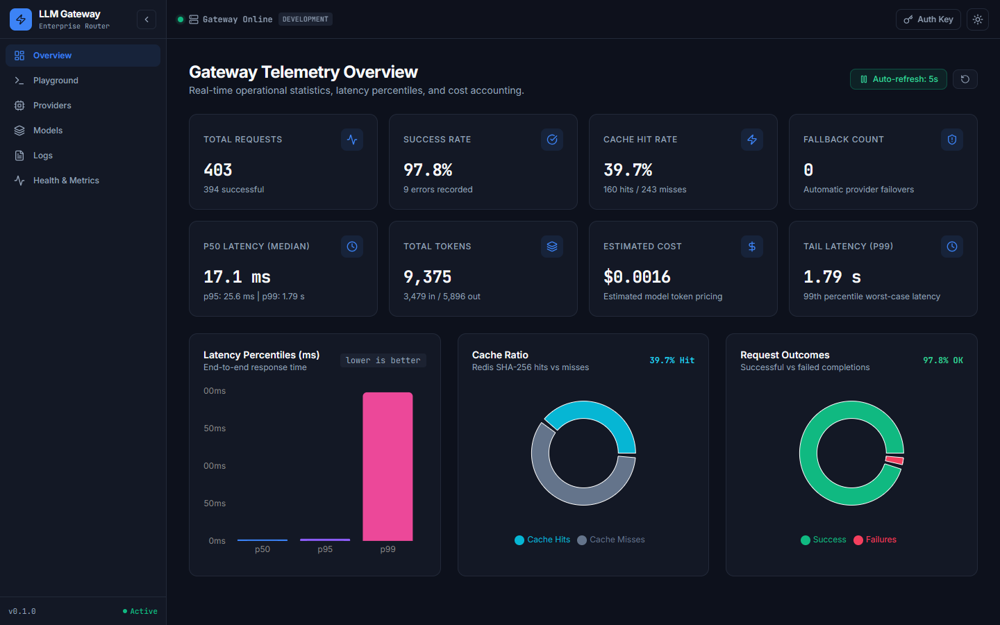
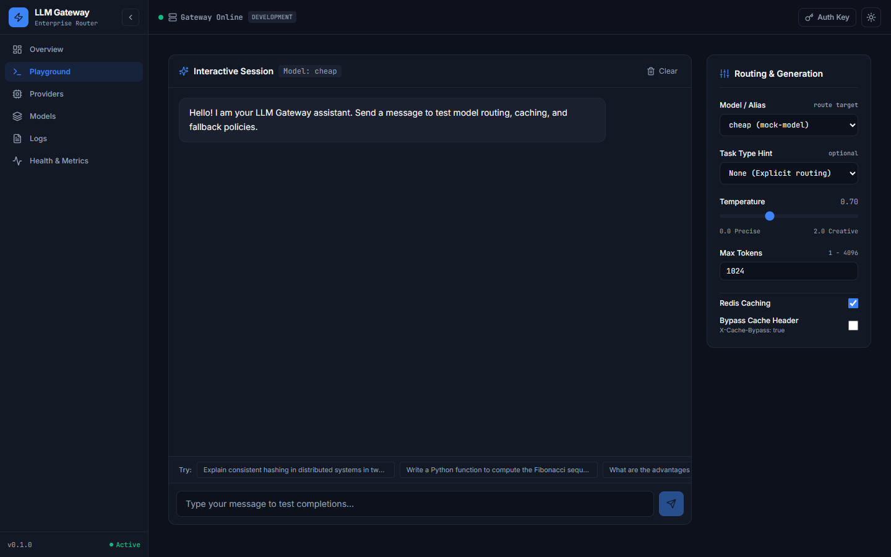
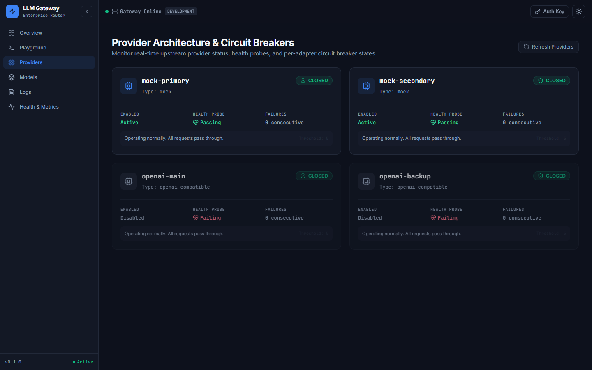
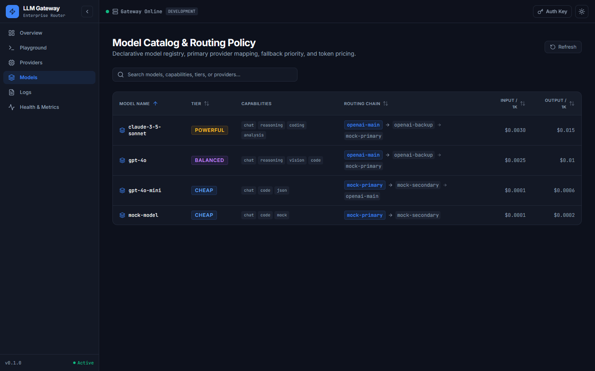
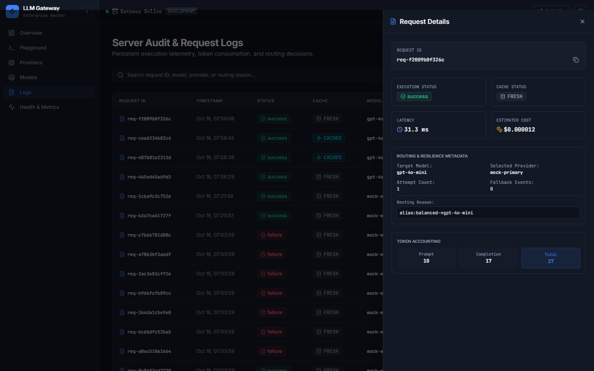
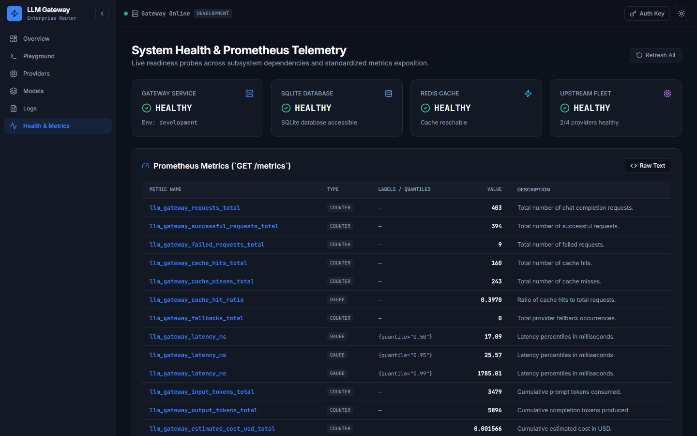

# 🚀 Enterprise LLM Gateway & AI Inference Router

[](https://github.com/organization/llm-gateway/actions)
[](https://github.com/organization/llm-gateway)
[](https://www.python.org/)
[](LICENSE)
[](#-offline-first--local-models)
[](frontend/)

A production-grade, fault-tolerant LLM Gateway engineered in Python (FastAPI, Pydantic v2, SQLAlchemy 2.x, Redis) that provides a unified, drop-in OpenAI-compatible API across cloud and local engines. Featuring **multi-tier exact & semantic caching**, **circuit breaker failover orchestration**, **real-time SSE token streaming**, **per-tenant API key budgets**, **automated PII & injection guardrails**, and a full-featured **React developer dashboard**.

---

## 🏗️ Architecture & Request Flow



---

## 🖥️ Production Web Dashboard & Developer Playground

A modern developer console built with **React 18**, **TypeScript**, **Tailwind CSS**, **shadcn/ui**, and **Recharts**.

| **System Overview & Real-Time KPIs** | **Interactive Developer Playground** |
|:---:|:---:|
|  |  |

| **Provider Health & Circuit Breakers** | **Model Catalog & Cost Pricing** |
|:---:|:---:|
|  |  |

| **Audited Request Logs & Detail Inspection** | **Health, Readiness & Prometheus Telemetry** |
|:---:|:---:|
|  |  |

---


## ⚡ 60-Second Quickstart

### Option A: One-Command CLI (Cross-Platform)

```bash
# 1. Inspect environment & diagnostic readiness
python gateway.py doctor

# 2. Start the gateway and background worker
python gateway.py start
```

### Option B: Windows Double-Click
Double-click `run_gateway.bat` — it automatically verifies Python, sets up virtual environments, installs pinned dependencies, and launches the gateway server with live Ollama model auto-detection.

### Option C: Docker Compose Full Stack
```bash
docker compose up -d
```
Starts Gateway (`:8000`), Redis (`:6379`), React UI (`:3000`), Prometheus (`:9090`), and Grafana (`:3001`).

---

## 📊 Real Measured Benchmarks

All metrics below were captured on local hardware against the live gateway test harness (`scripts/benchmark.py` and `scripts/load_test.py`):

| Operation | Throughput / Rate | Measured Latency |
|---|---|---|
| **Cache Key SHA-256 Generation** | **136,985 ops/sec** | 0.007 ms / op |
| **Model Routing Resolution** | **226,160 ops/sec** | 0.004 ms / op |
| **End-to-End Cache Hit p50** | — | **26.45 ms** |
| **End-to-End Uncached p50** | — | 45.95 ms (**1.74x speedup**) |
| **High-Volume Cache Hit Rate** | **75.51%** | (in 100-request load test batch) |
| **Pytest Test Suite Execution** | **66/66 Passing (100%)** | 40.69s total execution time |

---

## 🔌 100% Drop-In OpenAI SDK Compatibility

Point the official `openai` Python SDK directly to your local gateway URL. Zero code refactoring required:

```python
from openai import OpenAI

# Simply target the Gateway base_url
client = OpenAI(
    base_url="http://localhost:8000/v1",
    api_key="gw-prod-key-1",  # Or any configured Gateway key
)

# 1. Non-streaming completion
response = client.chat.completions.create(
    model="cheap",  # Routes automatically to local Ollama or mock
    messages=[{"role": "user", "content": "Explain consistent hashing in 2 sentences."}],
    temperature=0.7,
)
print("Answer:", response.choices[0].message.content)

# 2. Real-time token streaming
stream = client.chat.completions.create(
    model="balanced",
    messages=[{"role": "user", "content": "Write a python generator function."}],
    stream=True,
)
for chunk in stream:
    if chunk.choices[0].delta.content:
        print(chunk.choices[0].delta.content, end="", flush=True)
```

---

## 🌐 Offline-First & Local Model Support

The Gateway includes native support for offline and air-gapped environments:
- **Local Engine Adapter**: Out-of-the-box integration with Ollama (`http://localhost:11434`), LM Studio, vLLM, and llama.cpp.
- **`OFFLINE_MODE=true` Enforcer**: Completely disallows outbound internet traffic. Requests only route to local or mock providers.
- **Zero Incurred Inferences**: In-memory and local model configurations operate at `$0.00` per token with native token estimation.
- **Live Model Auto-Discovery**: Detects all installed Ollama models at startup and dynamically registers them into the active catalog (`GET /v1/models`).

---

## 🛡️ Enterprise Feature Matrix

| Feature | Description | File Reference |
|---|---|---|
| **Multi-Tier Caching** | SHA-256 exact match in Redis + offline subword semantic similarity index. | [`app/cache/`](app/cache/) |
| **Circuit Breaking** | 3-state state machine (`CLOSED`, `OPEN`, `HALF_OPEN`) preventing cascade failures. | [`app/resilience/circuit_breaker.py`](app/resilience/circuit_breaker.py) |
| **Automatic Fallback** | Multi-hop provider failover chains (e.g. `openai -> groq -> local -> mock`). | [`app/resilience/fallback.py`](app/resilience/fallback.py) |
| **Streaming (SSE)** | OpenAI-compliant Server-Sent Events with cached token replay and failover. | [`app/services/gateway.py`](app/services/gateway.py) |
| **Vector Embeddings** | Normalized `POST /v1/embeddings` adapter with caching and multi-provider support. | [`app/api/routes.py`](app/api/routes.py) |
| **Tenant Quotas** | Sliding-window RPM, daily cost caps, daily token allowances, allowed models. | [`app/persistence/api_keys.py`](app/persistence/api_keys.py) |
| **Guardrails** | Zero-allocation PII masking (Email, Phone, Credit Cards) and injection defense. | [`app/guardrails/`](app/guardrails/) |
| **Model Comparison** | `POST /v1/compare` runs prompts side-by-side with latency, token, and cost audit. | [`app/services/gateway.py`](app/services/gateway.py) |
| **Hot Reloading** | Live configuration reload (`POST /v1/models/reload`) without server restart. | [`app/routing/router.py`](app/routing/router.py) |
| **Observability** | Prometheus `/metrics`, Grafana dashboards, SQLite audit persistence, JSON logs. | [`deploy/`](deploy/) |
| **Web Dashboard** | React 18 + TypeScript + Tailwind + shadcn/ui + Recharts developer console. | [`frontend/`](frontend/) |

---

## 🏛️ Architecture Decision Records (ADRs)

Our core engineering design decisions and trade-offs are documented under [`docs/adr/`](docs/adr/):
- [**ADR 001: Offline-First Architecture & Local Model Orchestration**](docs/adr/001-offline-first-architecture.md)
- [**ADR 002: Multi-Tier Caching (Exact SHA-256 and Offline Semantic Similarity)**](docs/adr/002-multi-tier-caching.md)
- [**ADR 003: Fault Tolerance, Circuit Breakers, and Automatic Fallbacks**](docs/adr/003-resilience-and-fallbacks.md)

Detailed architectural walkthrough: [**`docs/ARCHITECTURE.md`**](docs/ARCHITECTURE.md).

---

## 🧪 Testing & Code Quality

The codebase enforces strict typing, zero secret leakage, and 100% test pass rates:

```bash
# Run unit, integration, and E2E test suites (66 tests)
pytest -v

# Run Ruff linter across application, tests, SDK, and CLI
ruff check app tests gateway_client examples gateway.py

# Run asynchronous benchmark harness
python scripts/benchmark.py
python scripts/load_test.py --requests 100 --concurrency 10
```

---

## 📜 License
Distributed under the **MIT License**. See [`LICENSE`](LICENSE) for details.
