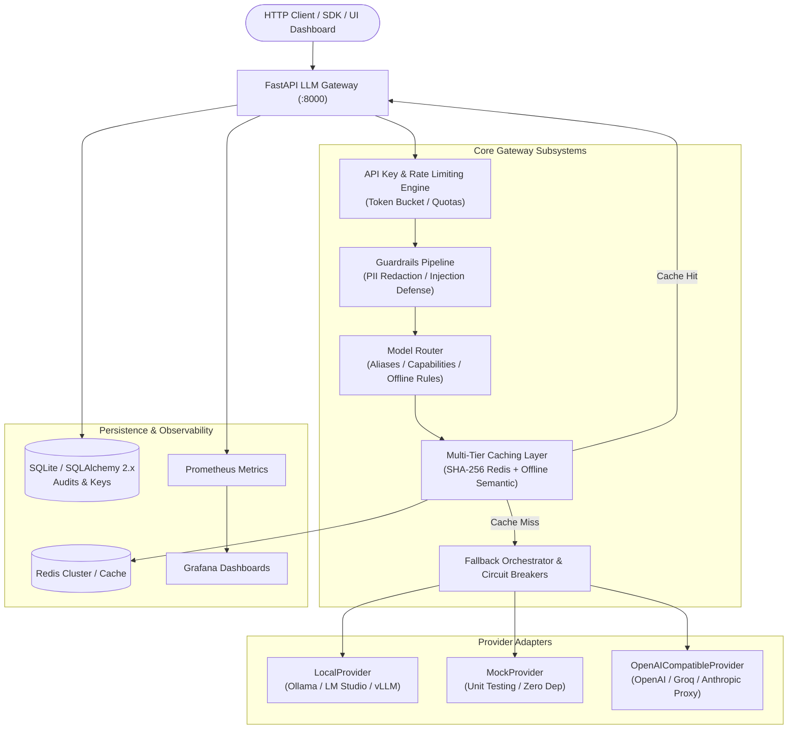
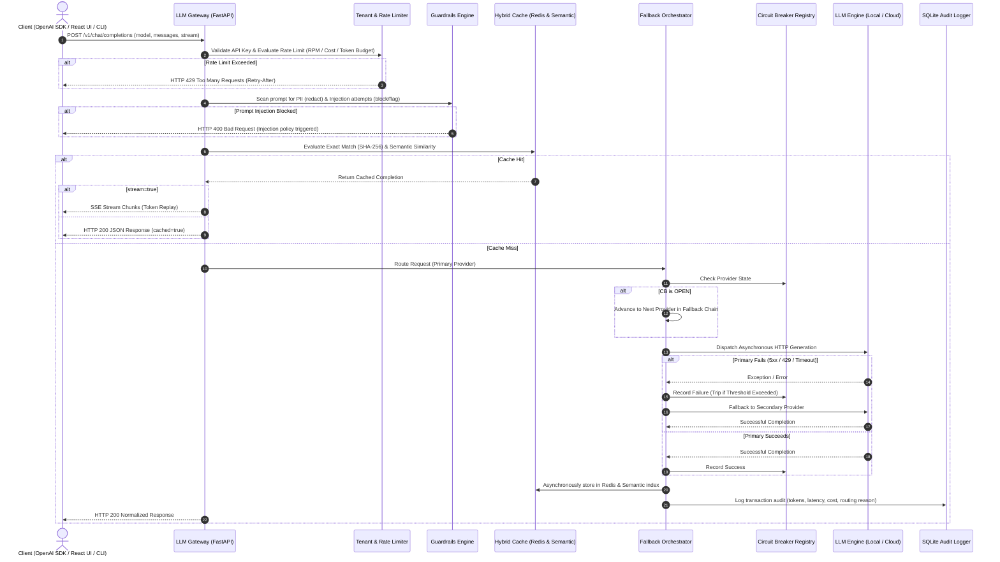

# LLM Gateway System Architecture

This document describes the architectural design, core subsystems, data flow, resilience strategies, and operational characteristics of the Production LLM Gateway.

---

## 1. High-Level Architecture Overview

---

## 2. Request Lifecycle & Sequence Flow

---

## 3. Subsystem Breakdown

### A. Provider Adapter Layer (`app/providers/`)
All downstream model engines conform to the abstract base interface [`BaseProvider`](file:///c:/Users/Inno/Desktop/lucky/llm-gateway/app/providers/base.py):
- **`LocalProvider`** (`app/providers/local.py`): Connects to local instances of Ollama, LM Studio, vLLM, or llama.cpp over standard REST interfaces. Operates at `$0.00` cost with automatic token estimation.
- **`MockProvider`** (`app/providers/mock.py`): Deterministic test double supporting latency simulation and configurable error injection for chaotic failover testing.
- **`OpenAICompatibleProvider`** (`app/providers/openai.py`): Direct integration with OpenAI, Groq, DeepSeek, or any OpenAI-compatible remote provider.

### B. Fallback Orchestrator & Circuit Breakers (`app/resilience/`)
- **Circuit Breaker**: Implements a three-state finite state machine (`CLOSED`, `OPEN`, `HALF_OPEN`). Providers experiencing consecutive failures beyond threshold (default 3) are tripped `OPEN` for a recovery duration (default 30s) to eliminate outbound latency penalties.
- **Ordered Failover**: Routes through an explicit chain of providers defined in `config/models.yaml` (e.g. `openai -> groq -> local -> mock-secondary`), ensuring continuous availability.
- **Deadline Management**: Implements two-layer timeout cancellation using `asyncio.timeout` for per-provider requests and overall request lifecycles.

### C. Multi-Tier Hybrid Caching (`app/cache/`)
- **Tier 1 (Exact SHA-256)**: Canonical JSON serialization of sorted messages, model name, and generation hyperparameters hashed with SHA-256. Lookups execute in `< 0.05ms` via Redis or in-memory fallback.
- **Tier 2 (Offline Semantic Index)**: Fast subword trigram vector projection mapping text to 128-dimensional unit spheres. High-confidence cosine similarity matches (`>= 0.85`) bypass the LLM completely.
- **Streaming Cache Replay**: Deconstructs cached strings into Server-Sent Event delta tokens streamed back with artificial pacing.

### D. Multi-Tenant API Key Management (`app/persistence/api_keys.py`)
- Supports tenant segmentation with dedicated policies:
  - Sliding-window Requests Per Minute (RPM) rate limits.
  - Daily cost caps (USD) and token allowances.
  - Whitelisted model restrictions.
- Rejects violations with standard HTTP 429 status codes and compliant `Retry-After` headers.

### E. Guardrails & Safety Pipeline (`app/guardrails/`)
- **PII Redaction**: Regex-based zero-allocation scanning and masking for Email Addresses, Phone Numbers (E.164 and domestic formats), and Credit Card / Payment Card Account Numbers.
- **Injection Mitigation**: Multi-heuristic scoring engine identifying prompt escape attempts, role manipulation, and delimiter smuggling with configurable actions (`allow`, `flag`, `block`).
